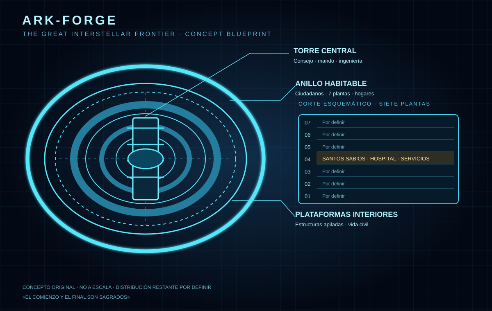

# The Great Interstellar Frontier 🌌

> **«Mientras uno de nosotros siga adelante, el Ark-Forge seguirá vivo».**

Archivo creativo del universo de **Forgeite Frenzy**: civilizaciones, arquitectura espacial, personajes, misiones, misterios y conceptos visuales.

## Explorar
- [Biblia del universo](docs/BIBLIA_DEL_UNIVERSO.md) — canon, ideas en desarrollo y misterios.
- [Arquitectura del Ark-Forge](docs/ARK_FORGE_ARQUITECTURA.md) — anillo habitado, siete plantas y Santuario de los Sabios.
- [Misiones y personajes](docs/MISIONES_Y_PERSONAJES.md) — rescates, expediciones y protagonistas.
- [Arte conceptual](art/) — dibujos originales en SVG, editables.

## Cómo trabajamos
- **Canon confirmado**: decisiones establecidas por la creadora.
- **Propuesta**: detalles sugeridos, aún pendientes de aprobar.
- **Misterio**: información que el jugador debe descubrir gradualmente.

Este repositorio contiene **lore y arte**, no el código del juego. El proyecto jugable está en [forgeite-frenzy-AF](https://github.com/pilukarts/forgeite-frenzy-AF).

> En el Ark-Forge, los niños y los mayores son sagrados: el comienzo y el final de una vida merecen protección y respeto.
