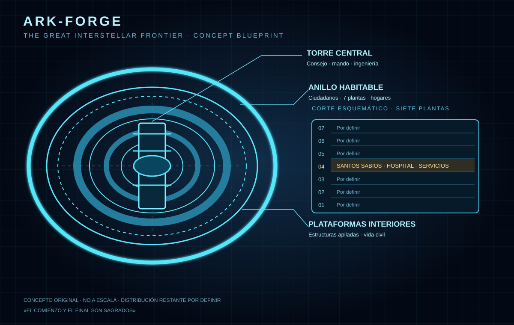

# Ark-Forge — arquitectura y sociedad

## Silueta confirmada
- Gran **disco espacial** con **aro exterior tubular y habitable**.
- En el interior del disco hay **múltiples plataformas horizontales superpuestas** para actividades civiles, formación, simulación y servicios.
- Una **torre central alta** contiene gobierno, Consejo y mando en los pisos superiores, con áreas administrativas y técnicas debajo.
- Evitar representarlo como una rueda de radios. El plano es **conceptual, no a escala**.

## Siete plantas del aro
| Planta | Uso |
|---|---|
| 7 | Pendiente de definir |
| 6 | Pendiente de definir |
| 5 | Pendiente de definir |
| **4 — central** | **Jubilados y Santos Sabios; área de servicios con hospital, cárcel y mortuorio** |
| 3 | Pendiente de definir |
| 2 | Pendiente de definir |
| 1 | Pendiente de definir |

**Importante:** la educación tiene un lugar propio dentro de las siete plantas, pero aún no se ha establecido cuál. No atribuir números arbitrarios a las plantas restantes.

## Santos Sabios
Los mayores jubilados son los maestros más experimentados de la civilización. En el Santuario central viven y participan en decisiones sobre el destino de los ciudadanos. Falta definir cómo se equilibran sus decisiones con la voluntad personal y con el Consejo de mando.

## Catástrofe y reconstrucción
Meteoritos **dirigidos por enemigos** golpearon el anillo. Se perdieron secciones, quedaron expuestos pasillos y servicios, y hubo evacuaciones y rescates. Las misiones de reparación reconstruyen una **ciudad viva**, no solo un casco metálico.

## Dirección artística
Azul marino y negro; líneas cian luminosas, detalles de ingeniería, cortes seccionales de plantas, pasillos, escuelas, barrios, hospitales y hangares. El dibujo SVG adjunto es una **primera lámina esquemática original**, no un plano definitivo.
