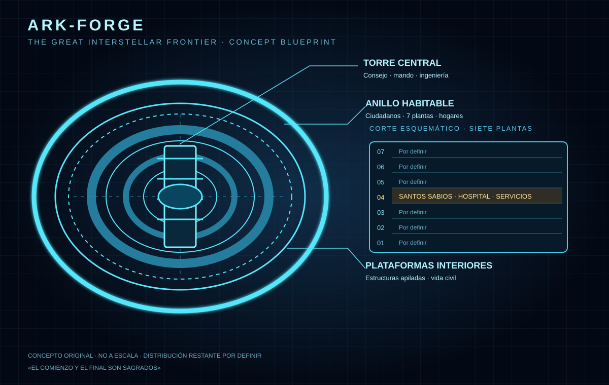

# 🚀 Frontier Ark: una ciudad entre las estrellas

[← Inicio](README.md)

## Arquitectura confirmada

Frontier Ark es una **inmensa ciudad-nave con forma de disco**. No es una rueda de radios.

- Su **anillo exterior tubular** está habitado y tiene **siete plantas**.
- En el interior se encuentran **plataformas horizontales superpuestas**, destinadas a actividades civiles y técnicas.
- Una **alta torre central** concentra funciones de mando, Consejo, administración e ingeniería.
- El plano actual es **conceptual y no está a escala**.

## Los siete niveles

| Nivel | Uso establecido |
|---|---|
| 7 | Por definir |
| 6 | Por definir |
| 5 | Por definir |
| **4** | **Mayores jubilados y Santos Sabios; hospital, cárcel y mortuorio en el área de servicios** |
| 3 | Por definir |
| 2 | Por definir |
| 1 | Por definir |

La educación tiene su espacio dentro del anillo, pero **su planta exacta aún no está confirmada**.

## Una ciudad que hay que proteger

Una catástrofe de meteoritos dañó zonas habitadas, escuelas, viviendas y servicios. El fenómeno llegó **sin pronóstico previo** y dejó a la población y a sus expertos desconcertados.

La reconstrucción no consiste solo en arreglar una estructura: cada reparación puede devolver un hogar, una escuela o un servicio imprescindible a sus habitantes.

La explicación completa del incidente pertenece al misterio de la aventura.

## Dirección artística

Azules profundos, estructuras industriales, pasarelas iluminadas en cian, ventanales, barrios interiores y grandes espacios habitables. El contraste visual debe recordar algo esencial: **dentro de una máquina gigantesca viven personas de verdad**.

[Ver sociedad y memoria →](SOCIEDAD_Y_MEMORIA.md)
