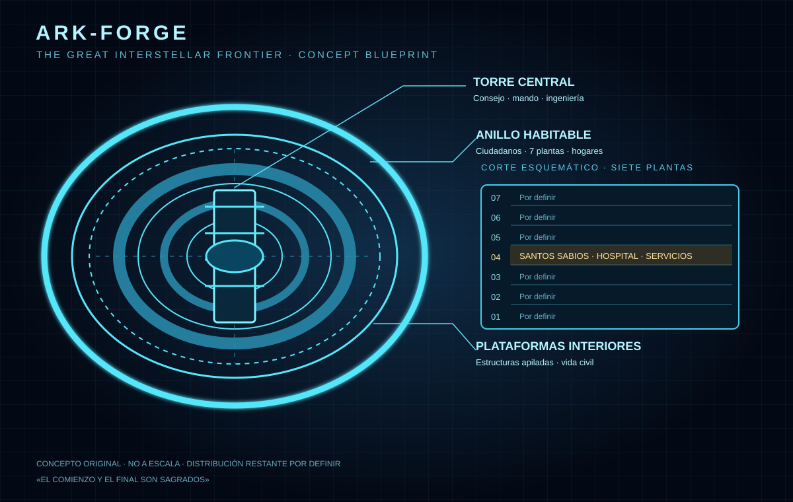

# 📚 Enciclopedia de The Great Interstellar Frontier

**Un universo de Pilukarts Studio · Guía pública sin grandes revelaciones**

> «Mientras uno de nosotros siga adelante, Frontier Ark seguirá vivo».

La Tierra dejó de ser un hogar habitable. Lejos de ella, generaciones enteras sobreviven a bordo de inmensas ciudades-nave. Exploran, reconstruyen y buscan un lugar donde volver a sentir la luz de un sol sobre la piel.

Esta enciclopedia reúne **el mundo, sus personajes y las ideas jugables** de *The Great Interstellar Frontier*, sin revelar el desenlace de la historia.

## Explora el universo

| Archivo | Qué encontrarás |
|---|---|
| [🌍 El universo y el éxodo](EL_UNIVERSO.md) | La Tierra, las naves hermanas y el sueño de un nuevo hogar |
| [🚀 Frontier Ark](FRONTIER_ARK.md) | La ciudad-nave, su anillo de siete niveles y la reconstrucción |
| [🏛️ Sociedad y memoria](SOCIEDAD_Y_MEMORIA.md) | Los Santos Sabios, los linajes y la Gran Guerra |
| [👩‍🚀 Personajes](PERSONAJES.md) | La comandante, los equipos y los habitantes del universo |
| [🎮 Misiones](MISIONES.md) | Las primeras operaciones de rescate y exploración |
| [🪐 Cómo se juega](EXPLORACION_Y_JUGABILIDAD.md) | Estrategia, construcción, decisiones y aventuras |
| [🔭 Glosario](GLOSARIO.md) | Términos, naves y lugares de consulta rápida |

## Arte conceptual

[Ver el plano editable](../art/ark-forge-blueprint.svg) · [Ver el cartel público](../art/frontier-poster-publico.svg)

## Cómo leer esta enciclopedia

- **Canon confirmado:** decisiones expresas de la creadora.
- **En desarrollo:** conceptos que pueden cambiar o ampliarse.
- **Misterio:** preguntas que la aventura permitirá descubrir; aquí no se adelantan las respuestas.

**Importante:** este es un archivo creativo de un videojuego en desarrollo. Las misiones descritas son **prototipos narrativos**, no una promesa de mecánicas ya implementadas. Esta enciclopedia está diseñada para compartirse públicamente y omite deliberadamente los secretos centrales.

[Volver al repositorio](../README.md)
